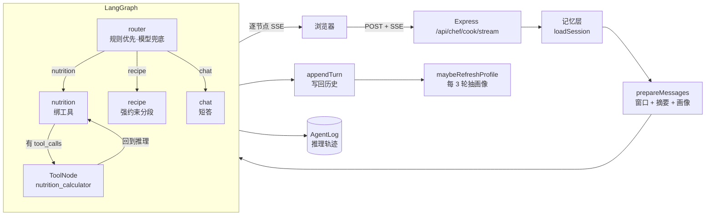

# AI 私厨 · 后端

一个带记忆的菜谱 Agent 服务：意图分流、按需调工具查营养库、跨会话记住用户口味。

配套前端：[ai-chef-frontend](../ai-chef-frontend)（Vue 3 + Vite）

---

## 技术栈

| 层 | 选型 | 用途 |
|---|---|---|
| Web | Express 4 | SSE 流式接口 |
| 编排 | LangGraph（StateGraph） | 意图路由 + ReAct 工具循环 |
| 模型 | DeepSeek（OpenAI 兼容协议） | 走 `@langchain/openai` |
| 存储 | MySQL + Sequelize | 会话、记忆、推理轨迹 |

## 架构



## 快速开始

```bash
# 1. 建库（表结构由 Sequelize 自动创建）
mysql -u root -p -e "CREATE DATABASE ai_chef_db DEFAULT CHARSET utf8mb4;"

# 2. 配环境变量
cp .env.example .env
#    填 DB_PASSWORD、OPENAI_API_KEY（放 DeepSeek 的 key）

# 3. 启动
npm install
npm run dev      # node --watch，改动自动重启
```

启动后访问 `http://localhost:3000/health` 确认存活。

## 接口

### `GET /health`

```json
{ "ok": true, "uptime": 12.3 }
```

### `POST /api/chef/cook/stream`

```json
{ "prompt": "番茄炒蛋有多少卡路里", "sessionId": "sess_ab12cd34" }
```

`sessionId` 必填——它决定对话历史的归属，缺了会直接 400（早期版本默认成 `'default'`，导致所有未传参的请求共用同一会话）。

响应是 SSE，逐条推 `data: {...}`：

| 事件 | 含义 |
|---|---|
| `{"intent":"nutrition"}` | 意图分类结果 |
| `{"status":"tool_running","tool":"nutrition_calculator"}` | 正在调工具 |
| `{"text":"..."}` | 回答正文片段 |

## 关键设计

### 1. 意图识别：规则优先，模型兜底

大部分问法用正则就能判准（「热量/卡路里/蛋白质」→ 营养，「怎么做/步骤/菜谱」→ 做法），只有规则漏掉的才花一次模型调用。好处很直接：**省掉大多数请求的分类开销**，延迟也更低。

规则顺序有讲究——营养类必须排在菜谱前。用户问「番茄炒蛋有多少卡路里」，两条规则都会命中，但真实意图是查营养。

规则层抽在 `src/agent/intentRules.js`，是纯函数，`npm test` 里有用例钉住。

### 2. 三级记忆

| 级别 | 载体 | 参数 | 作用 |
|---|---|---|---|
| 短期 | `Session.history`（JSON） | 窗口 6 轮 | 保证多轮连贯 |
| 中期 | `Session.summary` | ≤150 字 | 把挤出窗口的对话压成摘要，不丢关键信息 |
| 长期 | `Session.profile`（JSON） | 每 3 轮刷新 | 抽出过敏、忌口、口味偏好，每轮注入 system prompt |

三个设计取舍：

- **摘要和画像都用 `llmFast`（温度 0 + maxTokens 400）**，不用生成实例。分类只需要一个单词，拿大模型自由发挥是浪费。
- **画像每 3 轮才刷一次**，不是每轮。这是成本与新鲜度的折中。
- **压缩失败不裁剪历史**。早期实现里压缩失败会沿用旧摘要却照样丢 overflow，等于静默丢对话；现在返回 `null` 让调用方保留完整历史，只有连续失败到硬上限（3 倍窗口）才强制裁剪。

### 3. ReAct 循环

`nutrition` 节点绑了工具。模型这一轮要调就转 `tools` 节点，执行完回到 `nutrition` 继续推理，不调则结束。`recursionLimit` 设 10，防止工具循环把 token 烧光。

### 4. 降级策略

| 故障 | 处理 |
|---|---|
| 意图分类失败 | 当闲聊处理，不阻断对话 |
| 工具查库失败 | 返回"查询不可用"，并明确要求模型说明这不是查库结果，不能编数据 |
| 摘要压缩失败 | 本轮不裁剪，保留完整历史 |
| 画像抽取失败 | 记日志跳过，不影响本次回答 |
| 客户端断开 | `res.on('close')` 标记，循环内提前退出，不再继续推理 |

### 5. 推理轨迹落库

每个节点的输出、tool_calls、最终回答都记进 `AgentLog.executionTrace`，可用来回看"这句话为什么被分到了 nutrition"。这是调 prompt 的依据，不是日志留痕。

## 目录结构

```
src/
├── index.js                # Express 入口、SSE 推流
├── agent/
│   ├── chefGraph.js        # LangGraph 编排
│   ├── intentRules.js      # 规则层意图识别（可单测）
│   ├── llm.js              # 生成实例 / 判定实例
│   ├── memory.js           # 三级记忆
│   └── tools.js            # nutrition_calculator
├── models/
│   ├── Session.js          # 会话 + 记忆
│   ├── Recipe.js           # 菜谱 + 营养
│   └── AgentLog.js         # 推理轨迹
└── config/database.js      # Sequelize 实例（凭据全走 env）
scripts/
├── seed.js                 # 演示营养数据（幂等）
└── smoke.js                # 端到端冒烟测试（需服务已启动）
test/
└── intent.test.js
```

## 测试

```bash
npm test        # 单元测试：node --test，5 个用例
```

只测规则层——不连数据库、不需要 API key，`git clone` 完就能跑。

集成验证需要服务先起来：

```bash
npm run seed    # 写入 10 条演示营养数据（幂等，已存在会跳过）
npm run smoke   # 冒烟测试：意图路由 / 工具调用 / 三级记忆，8 项断言
```

`npm run smoke` 会真实调用模型，产生少量 token 消耗，所以没放进 `npm test`。

`scripts/seed.js` 里的营养成分是常见参考值，仅用于演示，不是权威检测数据。

## 数据模型

| 表 | 说明 |
|---|---|
| `Sessions` | `sessionId` / `history` / `summary` / `profile` / `turnCount` |
| `Recipes` | 菜谱内容 + 营养字段（`calories` / `protein` / `fat` / `carb`，每 100g） |
| `AgentLogs` | `userPrompt` / `executionTrace` / `finalResponse` |

营养字段允许为 NULL：库里历史数据可能没有营养信息，工具会返回"未知"而不是 `undefined`。

## 已知限制

- **流式是节点级的，不是 token 级**。每个节点跑完才推一次，用户会先等一段再看到整段文字。要真正的逐字输出，得换成 `model.stream()` 并把 token 直接转发。
- 同一 `sessionId` 并发请求没有加锁，`load → save` 之间会互相覆盖。单用户场景不会触发。
- 没有鉴权、没有限流，`cors()` 全开。仅本地演示用。
- `DB_SYNC_ALTER` 只用于加字段时手动同步，别在正式环境开。
